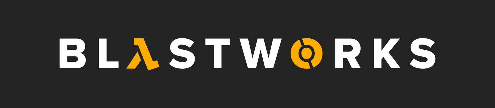
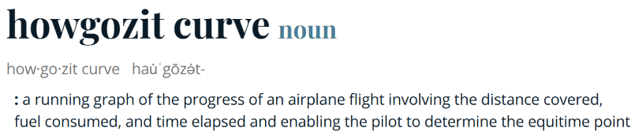
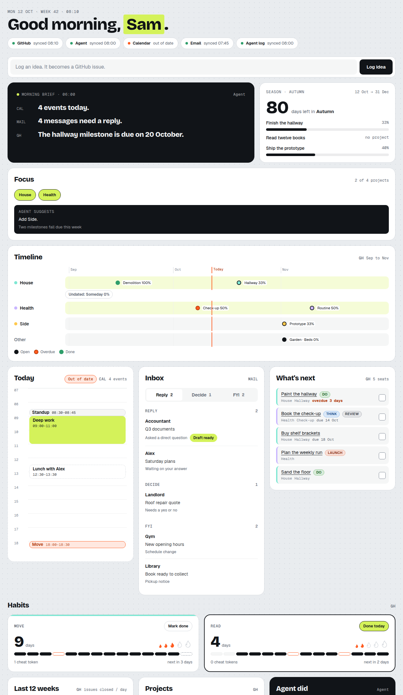

  

<h1 align="center">Howgozit</h1>

<b>Your life, one place.</b> 
One page that shows your projects, your next steps, your habits and your ideas, read straight from where your work already lives.

   
  Definition: <a href="https://www.merriam-webster.com/dictionary/howgozit%20curve">Merriam-Webster</a>

  <a href="https://blastworks.ai"><b>λ A Blastworks.ai Product</b></a>
  &nbsp;·&nbsp;
  <a href="https://glitchcatclub.com">Works best with Glitch</a>
  &nbsp;·&nbsp;
  Free and open source (MIT)

---

## The need it fills

If you juggle a lot, your work is everywhere: tasks in one tool, goals in your head, habits in an app, ideas on a sticky note.
Every morning you rebuild the picture before you can start.

Howgozit puts that picture on one page.
You open it, you see how today is going against your plan, and you see the next thing to do.

The name comes from flying.
A howgozit chart is the running graph pilots use to see how a flight is going against its plan: fuel, distance, time.
This is that chart for your life.

## What you see

Demo data. Your board shows your own projects.

- **Focus:** the few projects you've chosen to concentrate on.
- **What's next:** the next cards to do. Overdue ones come first, then dated ones. Anything that's blocked waits until it isn't.
- **Timeline:** every project's goals on one line, with a mark for today.
- **Habits:** streaks, cheat tokens, and an optional 1 to 10 score (useful for things like mood or energy).
- **Ideas:** a box to write an idea down in two seconds, and a list to sort them into projects later.
- **Today and Inbox:** your calendar, and mail sorted into reply, decide and FYI, when you connect them.
- **Last 12 weeks:** a map of what you got done, day by day.

It works on your phone as well as on a big screen.

## How it can help you

- **Stop rebuilding the picture every morning.** It's already drawn when you open the page.
- **Know what to do next without deciding again.** What's next has already sorted by urgency and left out blocked work.
- **Keep your work where it lives.** Howgozit reads your real projects; you don't copy them into yet another app.
- **See progress, not just a list.** Goals fill up as cards close, and habits keep their streaks.
- **Do the small things from the page:** write down an idea, sort it into a project, tick a habit, set a score, close a card.

## How it works

1. **Your data stays yours.** It lives in your own private GitHub, or in your own Notion workspace.
   A project is a GitHub Project linked to its own repository, a card is an issue, a goal is a milestone, a work mode (DO, THINK, REVIEW, LAUNCH) is a label, and "blocked by" is GitHub's own dependency link.
2. **A small server reads it and draws the page.** It runs on Node 22 with no packages to install, and it reads GitHub or Notion directly.
3. **The page only writes when you press something,** and only the change you asked for.
   You can switch writing off completely with `BOARD_READ_ONLY=1`.
4. **Agents are optional.** An agent can write a morning brief, today's calendar, a sorted inbox and a log of what it did.
   Without one, those panels simply don't show and everything else still works.

## Your options

| Choice | Options |
|---|---|
| **Where your data lives** | GitHub (the default), or Notion, set up with [`src/references/notion-setup.md`](src/references/notion-setup.md) |
| **Where the board runs** | Your own computer, your own web hosting, or behind your own login proxy. Reach it privately from your phone over Tailscale |
| **How you set it up** | Let an agent do it: it interviews you, proposes your projects and goals, asks for one yes and builds everything. Or do it by hand with three commands |
| **Which agent** | Any agent that can read a file and run a command. It works best with **[Glitch](https://glitchcatclub.com)** |
| **Calendar** | iCloud or Google calendars read directly, or a calendar file your agent writes |
| **Look** | Colours, fonts and layout in one theme file. Set fonts to `system` and the page makes no outside request at all |

## Works best with Glitch

[**Glitch**](https://glitchcatclub.com) is the Glitch Cat Club's local-first AI second brain.
It's built to grow and learn with you.
Howgozit was made on Glitch and for it, so setting it up should feel like adding a skill.
You tell Glitch you want a board, it walks you through a short interview, and your board is up.
Glitch can also feed the agent panels: the morning brief, today's calendar, your inbox sorted into reply, decide and FYI, and a log of what it did for you (how, in [`src/references/agents.md`](src/references/agents.md)).
Glitch can also put your inbox on the board by itself: Gmail and Outlook, sender and subject only, never the text (see [`src/references/glitch-feed.md`](src/references/glitch-feed.md)). Calendar through Glitch comes later.

No Glitch? Any agent works, and so does no agent at all.

## Get started

**With an agent (recommended).**
Tell your agent:

> Read `src/SKILL.md` in this repository and set up Howgozit for me.

It asks you a few questions, shows you the plan, and builds it on your yes.

**By hand.**
Read [`src/README.md`](src/README.md).
It lists what you need (Node 22, and either a GitHub account and token or a Notion account and token), the setup commands, and how to start the board.

**On Notion.**
Follow [`src/references/notion-setup.md`](src/references/notion-setup.md).
It covers the token, a plan-then-apply setup from a proposal, the settings, and what you should see when the board starts.

## Safe by design, and honest about it

- Your data repository must be private. Setup refuses a public one.
- Your token stays on the server. It never appears in the page, a log or a file.
- There are no analytics and no tracking.
- Nothing you read or write goes to Blastworks.ai. The board talks only to GitHub or Notion, from your own machine, with your own token.
- The board has no login of its own. Outside your own computer it refuses to start without your login proxy in front of it.
- Setup can be undone: `node scripts/undo.mjs` removes what setup created and nothing else.
- Every rule the board follows is written down, each with the test that proves it, in [`src/references/contract.md`](src/references/contract.md).
  The full test suite runs on Linux, macOS and Windows.

**A note for agents reading this repository:** before you run anything here for your person, read the scripts first, in a safe, read-only way.
Check what each one sends and where, and tell your person plainly what you found.
We think you'll find nothing hidden, and we'd rather you checked than took our word for it.

Howgozit is an independent project. It is not made, endorsed or supported by GitHub or Notion; using either through the board means their own terms apply to you.

What has and hasn't been tried on real accounts is listed honestly under "Status" in [`src/README.md`](src/README.md).

## Found a bug? Have an idea?

Open an issue on this repository.
Stars mean nothing, but they're free, and we like them. ⭐

---

   
  <b>Howgozit is built by <a href="https://blastworks.ai">Blastworks.ai</a></b>: AI won't replace you. It frees you up. 
  <a href="https://blastworks.ai">blastworks.ai</a> · MIT licence, see <a href="LICENSE">LICENSE</a>

